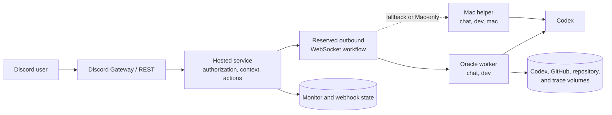

# Architecture

MiniSago separates Discord authority from model execution. The hosted service
owns identity, permissions, context retrieval, and Discord actions. Authenticated
workers connect outbound and run Codex.

## Deployment topology

Workers expose no public port. Oracle is the preferred always-on worker; the
Mac helper is a fallback and handles explicitly requested local Mac resources.

## Components

### Hosted service

The Bun service handles Discord events and REST calls, GitHub webhooks,
requester authorization, permission-filtered history, member lookup, worker
routing, and result delivery. It also owns reminders, feed monitors, voice
coordination, and persistent feature and subscription settings.

### Workers

Bridge secrets determine each worker's profile:

| Profile | Capabilities         | Selection                               |
| ------- | -------------------- | --------------------------------------- |
| Oracle  | `chat`, `dev`        | Preferred when compatible and available |
| Mac     | `chat`, `dev`, `mac` | Fallback or explicit Mac target         |

Workers advertise capacity, available repositories, and the repository that
owns chatbot behavior. A workflow reserves one worker through routing and
answering unless its required profile changes. Codex conversations have isolated
configuration and request credentials. Linux chat can reuse an app-server process
while creating and cleaning up a separate conversation and workspace per answer.

## Chat request lifecycle

1. The Gateway recognizes a mention, reply, owner DM, or active continuation.
2. The host authorizes the requester, gathers nearby messages, reserves a worker,
   and creates a short-lived MCP session.
3. Saved development threads recover their task and session from the core state
   store before routing. Other owner requests run a bounded router. It chooses `chat` for host-tool
   actions and uncertain requests, `mac` for explicit Mac resources, or `oracle`
   with a starting repository for development work. Development threads can clone
   additional accessible repositories into the same isolated task workspace.
4. The worker answers using the request, conversation, and supported attachments.
   It can fetch additional history, accessible guild search, member aliases,
   and metadata about a previous answer through `resolve_context`.
5. The host validates and posts the reply, reaction, or files, then revokes the
   MCP token and releases the worker.

Community and owner chat use GPT-6.1 Sol with medium reasoning. Owner routing,
voice, and social actions use GPT-6 Luna with low reasoning; development uses
GPT-6.1 Sol with high reasoning. Ordinary stages time out after two minutes.
Development runs until completion, cancellation, or worker disconnection.

## Context and MCP

discord-mail serves hosted Google consent pages under `/mail`. A host-only
encrypted SQLite store holds one read-only grant per approved mailbox and short
lived invitation/OAuth state. The MCP capability and search/read tools are bound
to owner-registered guilds/channels with current Discord membership and role
filters, or the owner’s private text DM. Workers receive only bounded results. See
[mail setup](mail.md).

The host exposes one Streamable HTTP MCP endpoint. Tokens expire after 16
minutes and bind to one workflow's requester, guild, channel, worker profile,
and repository. `resolve_context` batches history, guild search, member lookup,
and previous-answer metadata in parallel.

Other tools cover usage, reminders, voice, owner messaging, and expression
management. The request's capability catalog lists available and conditional
conversation, attachment, reaction, development, Mac, and MCP features.
Owner-only features are omitted for other requesters; the host binds identity
and destinations wherever possible.

A typed feature registry declares access modes, scopes, defaults, requirements,
DM/voice rules, and capability metadata. The shared access guard binds trusted
request identity, refreshes protected guild membership, and checks registration
at execution and before releasing read results. MCP tools must declare a feature;
owner-only tools remain owner-only. Integration credentials, Google resource ACLs,
and Calendar confirmation remain additional checks. See
[feature registration](feature-registration.md).

Owners can change feature coverage without deploying. Persisted channel rules
override guild rules. A separate subscription list selects destination channels
for Gamer Forum, X subscriptions, and TOEFL; jobs read it before delivery. X
monitors persist collected posts, request tool-free Traditional Chinese summaries
through a dedicated worker job at the daily 21:00 Taipei cutoff, and checkpoint
message progress per destination for retries. See
[Configuration](configuration.md) for registrations and role filters.

The Kyushu trip planner exposes guild-bound itinerary reads and typed schedule
edits without database credentials. Ordinary answers also receive the optional,
read-only [NTHU Campus Assistant MCP](https://api.nthusa.tw/mcp), covering campus
search, buses, courses, announcements, dining, libraries, newsletters, and
electricity. Its outage does not block unrelated answers.

Linux answers receive a request-local media MCP server. Attachments, member
avatars, and generated outputs share opaque `mediaId` references. Tools inspect
and transform images, extract frames, and produce bounded MP4, MP3, or GIF
outputs through fixed FFmpeg presets, or use bounded Python computation.
The worker exchanges bytes only through the request's bearer-bound media
endpoint. Tokens and local manifests are request-scoped. See
[Security](security.md#attachments-and-mac-files) for limits and isolation.

Reminders bind to the requester and current channel, with at most 50 active
reminders per requester. Relative timers need no timezone; wall-clock and
recurring requests need an IANA timezone or an unambiguous location.

Operators can add `skipIfImagePosted: { threadId, userId }` to durable reminder
state. Before sending, the host verifies the image thread belongs to the reminder's
channel, or shares a parent with its destination thread, and checks for that
user's image attachments or embeds since local midnight. Legacy reminders use
Asia/Taipei. A match skips that occurrence while
the recurring schedule advances; Discord failures leave it due for retry.
Ordinary edits preserve the condition. Chat tools show it when listing or editing
reminders but cannot configure it.

## Prompt harness and context policy

Every model call has three layers:

1. MiniSago policy and capability mode are developer instructions.
2. A fixed task instruction selects answering, routing, or social action.
3. Requests, Discord messages, attachments, repositories, and tool results are
   untrusted context, passed over standard input.

Routing and answering share Discord message normalization, including forwarded
snapshots on replies, and attachment preparation. Both receive image inputs and
bounded extracted text. Jev classifies only the execution route for text-only
context; the Codex router resolves the starting repository before thread creation.

Development jobs read repository `AGENTS.md` and `AGENTS.override.md` guidance,
up to 32 KiB combined. Other jobs disable implicit repository guidance.
Permissions, MCP bindings, command wrappers, and output schemas enforce
capabilities outside the prompt.

Context budgets keep the newest messages, truncate oversized items, and report
omissions explicitly. Taiwanese slang references load only when relevant terms
appear. Identity, trust, and output policy remain loaded. Policy, task, and
context versions and sizes are recorded in traces; private reasoning is not.

Host-derived addressing metadata distinguishes mentions, replies, owner DMs,
and continuations. The answer classifies relevant personal references to keep
its wording consistent; that classification is not posted to Discord. Genuine
self-introductions mark the self-name for host validation. Other unmarked
self-names get one tool-free, networkless repair attempt; unresolved violations
are rejected.

Codex memories are disabled. The host instead maintains a small curated memory
file per guild, injected as bounded untrusted context with stable entry IDs.
Authorized members can teach or correct durable server vocabulary and facts.
Temporary, uncertain, sensitive, or behavioral content is excluded. The
server-bound tool records requester and message provenance and accepts no guild
ID from the model.

Guild memory is human-readable Markdown in persistent storage. Serialized atomic
writes are committed to an independent local Git repository with no remote for
rollback. Discord history remains request-scoped. Sanitized operational traces
are retained for 14 days and exposed only as bounded previous-answer metadata.

Relevant shared public links use one bounded `read_link` MCP tool for websites
and social posts. A shared policy defines reading before content claims in both
worker and MCP instructions; page reads and Threads search share reader transport,
timeouts, response limits, and configuration. Broad `search_threads` calls require an
explicit search request. Protected sources keep their authorized tools and access
rules. Context retrieval retains webhook previews as labelled,
untrusted text without member aliases; webhook messages never acquire owner
authority from their display names. See [link reading configuration](configuration.md#shared-links-and-threads-search).

## Background features

The Gateway also handles improved Instagram, X, and Threads embeds, quick-reply
nudges, voice, and optional ambient reactions. Ambient messages are buffered;
a delayed evaluation may add one validated reaction and never an unsolicited
reply. Monitors and webhooks use persistent state to avoid duplicate delivery.
See [Operations](operations.md) for deployment, backups, and recovery.
